# Level Time — Your Leveling Companion for WoW Forever, Classic & Retail

**Level Time** tracks every minute of your leveling and helps you along the way: live XP/h and time-to-level, a full account-wide history with charts, dungeon quests and boss tips, a group finder, timers for campfire, food and sleeping bag, graphics beyond Ultra, speedrun splits and 70+ optional comfort tweaks. One lightweight addon, no external libraries.

> **One download for all versions:** WoW Forever (main focus), Classic Era, TBC Anniversary and Retail. Client-specific features turn on automatically and stay out of your way where they don't apply.
> **Languages:** English, German, French, Spanish.
> **First start:** a short setup wizard walks you through the important options. Everything else lives in `/lt`.

---

## ✨ New in 3.0

### Rebuilt settings — eight clear tabs, search, icons that make sense

Main window, Dungeons, Quests, Notices & warnings, Comfort, Interface, Stream & speedrun, General. A searchable sidebar per tab, a "show all options" switch for power users, and a preview button wherever something appears on screen.

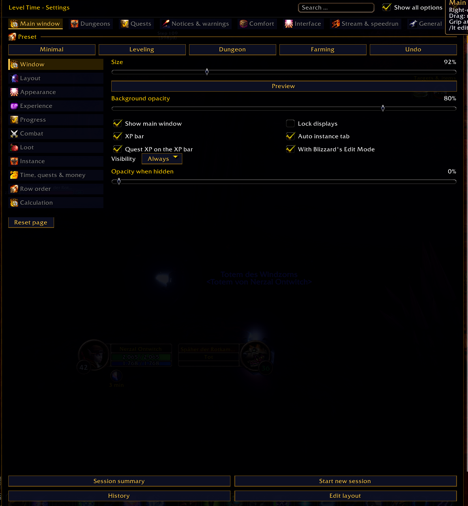

### Setup wizard

New players get a twelve-step tour: language, what the main window shows, dungeon and quest helpers, timers with live previews, loot sparkles, Beyond Ultra graphics. Skip any time, reopen with `/lt setup`.

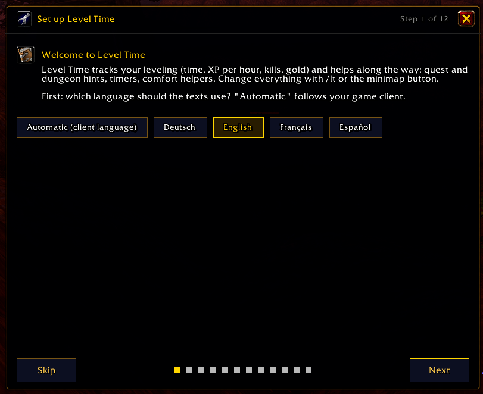

### Dungeon quests — never miss one again

Entering a zone lists every dungeon quest you can pick up there, with giver and coordinates. Accept one and Level Time shows the rest of the chain and the other quests for the same dungeon, marks givers on map and minimap, and checks your quest log when you zone into the instance. Turn hints off per character and dungeon.

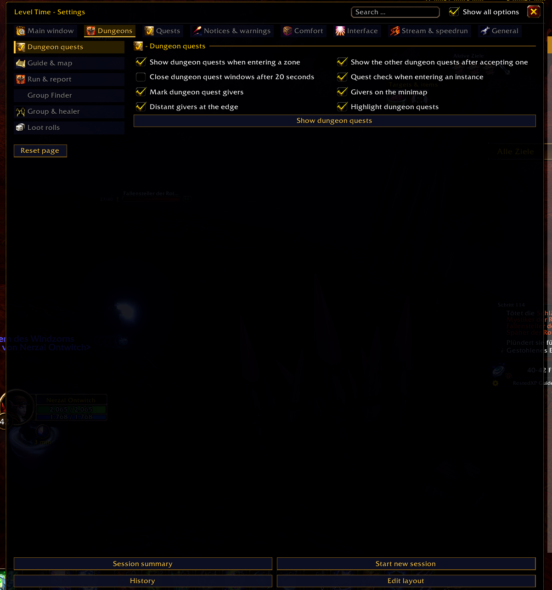
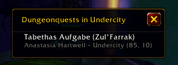 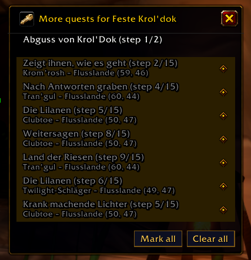

### Dungeon guide and run tracker

Boss portraits, roles and what to watch out for (tank, adds, dispel, interrupt) — with clear type icons. The run tracker shows each boss kill with split time against your best run, kills, deaths and XP/h.

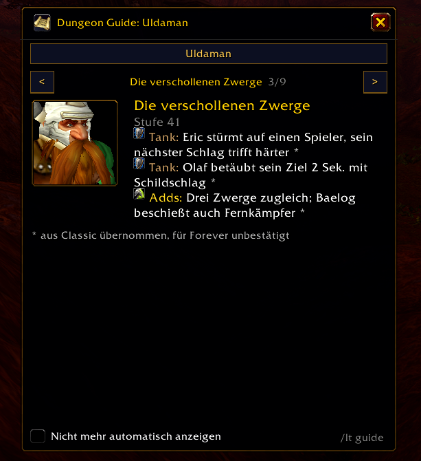 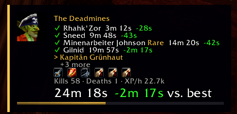

### Group play: loot rolls and healer helper

See who rolled Need, Greed or Pass right on the roll frame, keep a compact roll card until the winner is decided, and log every roll in your history. Healers get automatic party callouts for low mana, crowd control on them and aggro.

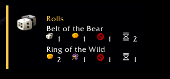
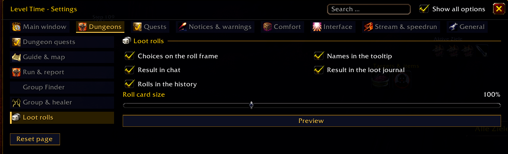
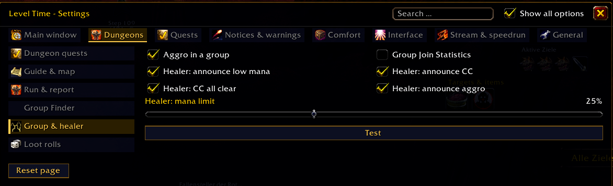

### Group finder (WoW Forever)

A Blizzard-style group finder with filters by role, class, level and language, "fits me" matching, friends first, and which of your open dungeon quests a group's dungeon covers. Opens from its own minimap button or `/lt lfg`.

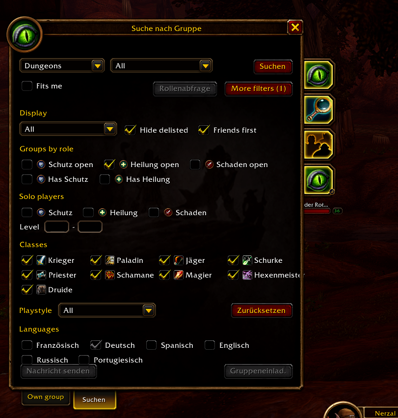

### Campfire, food and sleeping bag (WoW Forever)

Countdowns until camp benefits, Well Fed and Well Rested kick in, a notice per Well Rested stack, and reminders when a buff is missing — reminders disappear by themselves once you have the buff again.

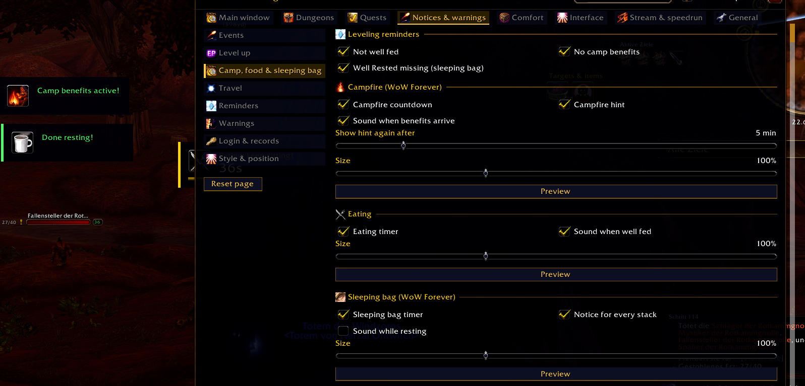

### Beyond Ultra graphics (WoW Forever)

Settings the Forever graphics menu doesn't offer: grass density and distance, object and terrain detail, reflections, weather, water ripples, sun shafts — plus always-sharpen and HDR. One click for recommended values; turning it off restores yours. Optionally switch back to your normal values inside instances.

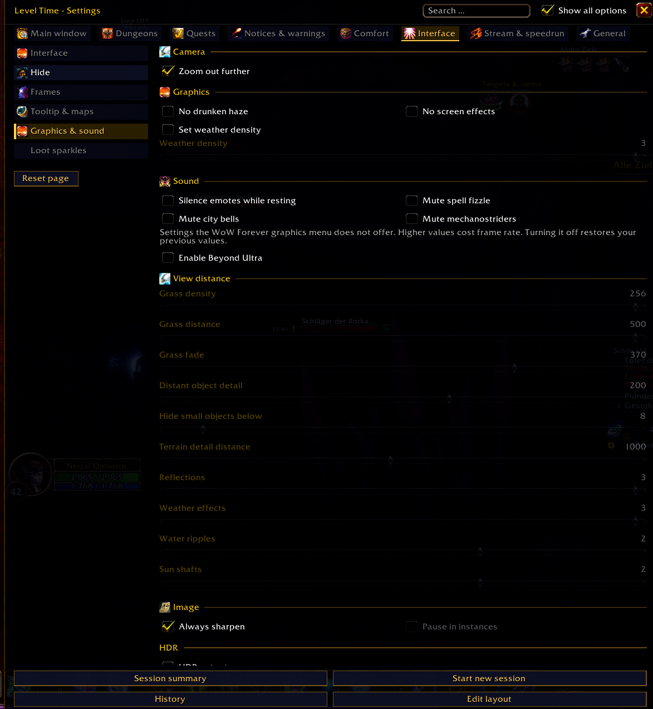

### And much more

- **Collapsed buff bar:** keep Water/Lightning Shield charges visible while Blizzard's buff bar is collapsed.
- **Objective tracker** stays collapsed the way you left it after `/reload`.
- **Bags full:** delete the cheapest junk with one click (up to three offers, never reagents or quest items).
- **Changelog** with collapsible days, scroll bars everywhere, clearer tabs.

---

## Why Level Time Stands Out

- **📊 Live HUD & 7 display layouts:** `/played`-synced level time, session and instance tracking. Table, Info Bar, Compact, Text-Only (OBS), Clock, Slim XP Bar and Tiles. Move, scale and snap everything in **Edit Mode** — and hide Blizzard UI elements with a click.
- **📖 Account-wide history & charts:** every level, session, dungeon run, kill, death cause, rare drop, zone and gold flow for all characters — with 9 interactive charts and heatmaps.
- **⏱️ Speedrun splits & records:** LiveSplit-style panel with gold splits, PB comparisons, bracket forecasts, quest splits, SSF verification and `.lss` export.
- **🧭 Quest & dungeon assistant:** quest levels, nameplate objective counters, a quest item and target button, self-learning quest mobs and givers, dungeon quests and boss tips.
- **🛠️ Comfort suite:** 70+ optional quality-of-life tweaks (100% own code, fully reversible) — repairs, junk, quests, chat, tooltips, frames, loot rolls, graphics.
- **🔔 Alerts & healer callouts:** level-up window with new trainer skills, buff/food/camp reminders, low-health highlight, bag and durability warnings, mana/CC callouts.
- **🎥 Streamer-ready:** one-command Stream Mode, chroma-key backgrounds for OBS, name anonymization and live session recap cards.

---

## 📊 Live Window & Real-Time Statistics

A sleek, movable window tracks one scope at a time via quick tabs: **Level N | Session | Instance** (optionally auto-switching when you enter a dungeon or raid). A session persists across `/reload` and short disconnects up to 5 minutes.

### What You Can Track (Every Row Toggleable & Reorderable)

- **Time & Breakdown:** Exact time on current level (synced with server `/played`, accurate even if installed mid-level) and session time, broken down into combat, flight paths, AFK, and resting.
- **Experience & Pacing:** XP/h (overall and rolling last 15 min), gained XP, time to level, time to max level, kills to level, quests to level, and unsubmitted quest log XP.
- **Enhanced XP Bar:** Shows rested bonus and optional yellow preview for completed quests in your log. Hover for exact values (current/needed XP, missing XP, rested & quest XP).
- **XP Sources & Locations:** Breakdown by kills, quests, exploration, and gathering — plus location splits (open world, dungeon, raid, battleground) and rested XP gained/remaining.
- **Combat & Hardcore Metrics:** PvE kills (XP-yielding kills incl. group kills), kills/h, 15-min kill rate, PvP honorable kills, elite/rare kills, deaths with time spent dead, K/D ratio, **near deaths**, and **time survived without dying**.
- **Loot & Economy:** Items looted (stacked by quantity, excluding vendor purchases), items/h, 15-min loot rate. Detailed income (loot, quests, vendors, mail, AH, trade) with Gold/h, plus expenses (repairs, vendors, flights, trainers) and Reputation/h.
- **Instance & Lockout Tracker:** Live duration and XP of the active run (pauses/resumes if you zone out and re-enter), daily instance count, and an **hourly realm instance lockout tracker** showing exactly when the next slot frees up.
- **Goals & Splits:** Live split delta against your comparison and custom target level forecast (`/lt goal 30`).

### Customization, Layouts & Integration

- **7 Layouts:** Table, Info Bar (single line), Compact (time, XP bar + up to 3 metrics), Text Only (outlined, background-free for OBS), Clock (large timer), Slim XP Bar (text always/hover/never), and Tiles Grid.
- **4 Quick Presets:** _Minimal, Leveling, Dungeon,_ and _Farming_ (with undo support).
- **Smart Calculation:** Automatically exclude AFK time or zero-XP idle periods from XP/h; adjustable rolling window for kills/quests to level.
- **Themes & Styling:** _Classic, Flat, Minimal,_ and _Colorblind_ themes. Customize accent colors, fonts, outlines, bar textures (built-in, Blizzard, or LibSharedMedia), and dynamic value coloring (e.g., XP/h colored relative to your average).
- **Smart Visibility Rules:** Show always, out of combat, in combat, in instances only, on mouseover, or hide at max level — with smooth fade-to-transparency instead of abrupt hiding.
- **Interactive Edit Mode (`/lt edit`):** View all displays with sample data simultaneously. Drag, mouse-wheel scale, arrow-key nudge, align with grid & snapping, or configure via right-click.
- **Chat & Broker Integration:** Login recap of your last session + estimated alts that reached full rested XP; level-up chat summaries (with optional party/guild announce); native **LibDataBroker (LDB)** feed for Titan Panel, ElvUI, and Bazooka.

---

## 📖 Account-Wide History, Journal & Charts

Open via `/lt history` or `Shift + Left-Click` on the minimap button. Inspect, sort, filter, and compare all characters across your account across **7 dedicated tabs**:

1. **Levels:** Complete table of every level (time, XP/h, kills, deaths, quests, gold), exact timestamp & `/played` timeline, activity breakdown (combat/flight/AFK/dead), XP sources, and personal records.
2. **Sessions:** Full log of every play session with start time, duration, level range, XP/h, kills, deaths, quests, and gold.
3. **The Chronicle (Journal):**
   - **Kills:** Every creature and player with timestamp, type (PvE/PvP, Elite, Rare), level, and zone.
   - **Deaths:** Timestamp, level, zone, and exact cause (attacker + spell, falling, drowning, etc. — pulled directly from the Death Recap on Retail & WoW Forever).
   - **Quests & Loot:** Every completed quest and rare+ item drop (with likely source) and interactive game tooltips on hover.
   - **Instances:** Every dungeon, raid, and scenario run with duration, XP, XP/h, kills, deaths, and reputation.
   - **Group Loot Rolls:** Complete history of every group roll (winner, item, roll value, choice, and dungeon).
   - **Near Deaths:** Logged survival calls (Classic Era & TBC).
4. **Analysis (Zones, Rep & Gold):** Best leveling zones ranked by XP/h, kills, and deaths; faction reputation gains; daily, weekly, and monthly gold balance. Plus quest turn-in efficiency (XP/min) and reward value hints.
5. **9 Interactive Charts:** Time per level, XP/h per level, kills per day, top enemies, death causes, XP/h by zone, daily/weekly play time, session XP timeline, **Playtime Heatmap** (weekday × hour), and multi-character progress curves.
6. **Speedrun & Records:** All-time personal records across characters (best 60-min XP, peak session XP/h, biggest single XP drop, fastest level, best dungeon run) with optional on-screen record alerts.
7. **Character Compare:** Side-by-side comparison of all alts sorted by leveling speed, including tracking coverage percentage and live rested XP estimates.

_Note: Unlimited history without memory bloat — older journal entries automatically offload into the included load-on-demand archive module (`LevelTimer_Archive`). Every table supports text search, column sorting, and **CSV Export**._

---

## ⏱️ Speedrunning & Splits

Turn WoW into a competitive speedrun environment via the **Speedrun** tab and `/lt splits`:

- **LiveSplit-Style Panel:** Dedicated movable window showing your active level, the last 3–15 levels, total time, and server `/played`.
- **Flexible Comparisons:** Race against your best time per level across alts, your Personal Best (PB) run (all classes or same-class only), or any imported run (`/lt compare <name>`).
- **Gold Splits & Forecasts:** Purple highlights, sound, and chat lines for record splits (with optional yellow tolerance band). Live pacing forecasts for 1–10, 1–20, and 1–60 brackets against your PB, Sum of Best, and world records.
- **Built-In Speedrun.com Records:** Offline snapshot of official _WoW Classic Leveling SSF Softcore_ records (overall and class-specific) compared directly against your `/played`.
- **Custom & Quest Splits:** Trigger custom splits via `/lt split [name]` or keybind (saveable as templates for new characters), plus automatic **Quest Splits** measuring exact time from quest accept to turn-in.
- **Verification, Integrity & LiveSplit Export:** Automatic run categorization (_SSF, Solo, Group, Boosted_), tracking coverage verification (partial levels never pollute best times), tamper-check codes (`/lt runs verify`), text sharing, and native **`.lss` export for LiveSplit** (`/lt runs lss`).
- **Multiplayer Racing & SSF Helper:** Optional real-time split exchange with party members or inspected players. Dedicated **SSF Rule Helper** displaying rested XP, logout counts, hourly instances, a VOD clock, and warnings if Trade, Mail, or AH windows open.
- **Auto-Screenshots:** Optional milestone captures every 5 levels, at max level, first dungeon entry, or epic loot drops.

---

## 🔔 Smart Alerts, Timers & Healer Callouts

All visual notifications share a clean, movable card queue with customizable icons, size, duration, and banner/text styling:

- **Custom Level-Up Window:** Replaces Blizzard's banner with a detailed breakdown of HP, Mana, and stat gains (`Before -> After`), new talent points, and **newly unlockable skills waiting at your class trainer** (Classic/TBC/Forever). Includes _Modern, Alliance,_ and _Horde_ themes.
- **Buff, Rest & Flight Timers:**
  - Countdown for eating (_Well Fed_), plus **WoW Forever** exclusives: Campfire timer, Cozy Sleeping Bag `/sleep` rest countdown (with notifications per _Well Rested_ stack), and Skyborne charge reminders.
  - **Flight Path Timer:** Accurate countdowns using your recorded flights, built-in database, reverse-route calculation, or distance estimation (`~`), plus flight durations directly on flight map tooltips.
  - **Smart Buff Reminders:** Periodic out-of-combat reminders (every 1–30 min) for missing food buffs or class buffs (armors, Fortitude/Intellect, shields, weapon enchants, poisons, pets, aspects).
- **Survival & Maintenance Warnings:** Almost full bags, low gear durability, trainer visit reminders on even levels, low hunter ammo, approaching instance lockouts, breath/fatigue timers, break reminders, and a **Low-Health Emergency Highlight** (flashes screen edges and glows healing potions, healthstones, and defensive spells on Classic Era/TBC).
- **Group Reports & Healer Callouts:**
  - Automatic or manual (`/lt report`) dungeon summary on exit (duration, XP, kills, loot money) and clickable quest progress updates.
  - **Healer Protection:** Automatic party/raid warnings for low mana, active Crowd Control on you (with CC type and duration + "all clear" message when broken), and aggro alerts.

---

## 🧭 Dynamic Quest Assistant

Built-in questing enhancements that learn organically as you play — **no heavy static database required**:

- **Actionable Quest HUD:** Movable _"Targets & Items"_ bar featuring a button for the nearest usable quest item (including items in your bags required for active objectives) and a **Quest Target Button** with optional Skull marker macro.
- **Nameplate & Tracker Upgrades:** Quest levels `[12]` / `[12+]` in logs, gossip, and trackers; kill-quest icons and live objective counters (`3/8`) right next to enemy nameplates.
- **Account-Wide Self-Learning:** Automatically records quest mobs, items, and quest givers/turn-ins across your characters — adding unit tooltips on Classic and placing quest pins on your World Map.
- **Loot Sparkles & Soft-Target Glint:** Keeps quest item sparkles active regardless of graphics presets (WoW Forever) and adds proximity glints to ore veins, herbs, quest objects, and lootable corpses (bright in range, dim out of range, grey if skill is too low).
- **Log & Ghost Utilities:** One-click removal for gray quests (with confirmation), full-log warnings, leftover quest item detection, smart reward advisor (highest sell value / item level), and a **Corpse Arrow** with distance while dead.

---

## 🛠️ Comfort Suite (70+ Optional QoL Tweaks)

Spread over the **Comfort** and **Interface** tabs with a searchable sidebar. Every option is optional, runs on 100% native code, and cleanly restores your previous CVars/settings if turned off. _(Hold `Shift` anytime to bypass automations on the fly)._

- **Automation:** Auto-repair (guild bank support), auto-sell junk, _"Train All"_ button at class trainers; auto-accept/turn-in quests, smart reward selection, single-option gossip skip, and custom exclusion lists (ignores gray, PvP, repeatable, and paid quests); auto-accept summons (after 10s), resurrections, and BG spirit release.
- **Group Loot Roll Tracker:** Live counters for _Need, Greed, Pass, Disenchant,_ and _Transmog_ (plus undecided players) directly under Blizzard's roll frames. Keeps a compact tracking card on screen after you roll until the winner is decided.
- **Chat Enhancements:** One-click Copy Chat button (`/lt copy`), global font sizing, edge-to-edge placement, persistent chat history across `/reload`, top input box, arrow-key navigation without `Alt`, and filters for drunk messages, combat spell links, chat buttons, or fade.
- **Interface & Frames:** Move and scale any Blizzard window (`Ctrl + Wheel`), square minimap with wheel zoom, coordinates & death pins on the world map, durability & volume sliders on the character sheet, undress/tabard buttons in the dressing room, and an instant **ID & Wowhead Link Card**.
- **Classic Frame Polish:** Class colors, elite/rare dragon borders, and Druid mana bars on the default player/target frames; cursor tooltips, class-colored tooltips, and "kills to level" directly in mob tooltips.
- **Hide Any Blizzard UI Element:** Taint-free hiding of player, target, focus, party, pet, boss, and arena frames, cast bars, minimap, buffs, quest tracker, chat, action bars, micro menu, bag bar, and XP/rep bars — toggleable directly inside `/lt edit`.
- **Social & System:** Auto-invite via whisper keyword, auto-accept friend/guild invites, block duels/trades/shared quests/BNet spam. Faster auto-loot, bypass loot/delete confirmations, instant movie skip, extended camera zoom, mute annoying sounds (mechanostriders, city bells, spell fizzle, resting emotes), and ready-check/BG queue timers.

---

## 🎥 Streamer Tools & Profiles

- **One-Click Stream Mode (`/lt stream`):** Instantly enables large broadcast alerts and anonymizes character/realm names (restores normal settings when toggled off).
- **OBS Chroma Keying:** Solid green or magenta borderless backgrounds for clean window keying.
- **Live Session Recap Card (`/lt recap`):** Broadcast-ready summary card showing session duration, levels gained, XP, kills, deaths, best drop, and deadliest enemy.
- **Profiles & Data Portability:** Save, switch, and export/import named settings profiles and speedrun records via text strings, plus `.csv` table exports and `.lss` LiveSplit files.

---

## ⌨️ Slash Commands

Use `/lt` or `/leveltimer`. _(Tip: Every UI window can also be configured via Right-Click, or moved via `/lt edit`)._

<strong>Click to expand all Slash Commands</strong>

| Command                                            | Description                                                                           |
| :------------------------------------------------- | :------------------------------------------------------------------------------------ |
| `/lt` or `/lt config`                              | Open the settings menu (with search bar & per-page reset)                    |
| `/lt edit`                                         | **Edit Mode:** Move, scale, snap, and hide Level Time & Blizzard UI elements |
| `/lt history`                                      | Open the 7-tab Character Chronicle, Charts & Records window                  |
| `/lt splits`                                       | Toggle the LiveSplit speedrun panel                                          |
| `/lt recap`                                        | Open the live Session Summary Card                                           |
| `/lt stream`                                       | Toggle Stream Mode (anonymize names + big alerts)                            |
| `/lt show` / `/lt hide`                            | Show or hide the live statistics window                                      |
| `/lt lock` / `/lt unlock`                          | Lock or unlock display positions                                             |
| `/lt compact` / `/lt bar`                          | Quickly toggle between Table, Compact, and Info Bar layouts                  |
| `/lt newsession`                                   | Archive the current session and start a fresh timer                          |
| `/lt resetinstance`                                | Reset the active instance tracker (does not reset the game instance)         |
| `/lt goal <level\|off>`                            | Set, view, or clear your target level forecast (e.g., `/lt goal 30`)         |
| `/lt compare <best\|pb\|name>`                     | Set split comparison to best-per-level, PB, or a specific run                |
| `/lt split [name\|undo\|template]`                 | Trigger a custom split, undo the last split, or save as template             |
| `/lt runs <import\|backup\|verify\|lss>`           | Manage speedrun data, verify check codes, or export to LiveSplit             |
| `/lt profile [name\|save\|delete\|export\|import]` | Manage and share settings profiles                                           |
| `/lt copy`                                         | Copy text from the active chat window                                        |
| `/lt report`                                       | Post an instance summary to your party chat                                  |
| `/lt sync`                                         | Force a manual `/played` sync with the server                                |
| `/lt minimap`                                      | Toggle the minimap button                                                    |
| `/lt reset`                        | Reset all display positions                      |
| `/lt setup`                                        | Reopen the setup wizard                                                               |
| `/lt guide [dungeon]`                              | Open the dungeon guide (WoW Forever / Classic)                                        |
| `/lt lfg`                                          | Open the Level Time group finder (WoW Forever)                                        |
| `/lt changelog`                                    | Show what changed recently                                                            |
| `/lt help`                                         | Show command help                                                                     |

---

## 💡 Good to Know & Ecosystem

- **Account-Wide Intelligence:** Statistics are recorded per character and stored account-wide so you can compare alts at any time.
- **Instant Accuracy:** Level time and XP/h sync directly with the server's `/played` data, meaning your current level metrics are accurate even if you install the addon mid-level.
- **Client API Differences:** Retail and WoW Forever restrict certain combat values ("secret values" like enemy health/mana or combat log events). Level Time automatically uses smart fallbacks (like reading the native Death Recap or XP diffs) and cleanly hides unsupported metrics (like Near Deaths on Retail).
- **Sister Addon for Streamers:** Pair with **[Level Time Goals](https://www.curseforge.com/wow/addons/streamer-goals)** to display interactive on-screen goal cards (reach level X, kill N mobs, loot items, win BGs, or custom challenges).
- **Feedback & Bug Reports:** Found a bug or have a feature request? Visit [GitHub Issues](https://github.com/Noobygames/level-time/issues).
